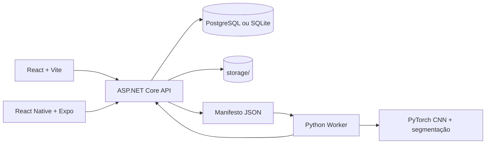

# SAM Training

Plataforma full-stack para organizar imagens de ativos financeiros, executar fine-tuning de um modelo de classificação e segmentação em PyTorch e consultar inferências por meio de interfaces Web, Mobile e uma API REST.

> **Estado atual:** o projeto é um protótipo funcional para experimentação. O pipeline de ML usa uma arquitetura CNN própria chamada `SAM3FintechClassifier`; ele não carrega os pesos oficiais do Meta SAM 3. Quando o script Python não está disponível ou falha, a API usa um fallback heurístico para manter a experiência de demonstração.

## Funcionalidades

- Cadastro e manutenção de categorias de imagens.
- Upload de imagens via Web, Mobile ou API.
- Organização do dataset em `Train`, `Validation` e `Test`.
- Filtros, paginação, estatísticas e indicador de saúde do dataset.
- Exportação automática de um manifesto JSON para cada treinamento.
- Enfileiramento e acompanhamento de jobs de treinamento.
- Worker Python em modo daemon, consultando a fila da API.
- Registro de loss, acurácia, mIoU, logs e checkpoints.
- Inferência com classificação, máscara e histórico de predições.
- Dashboard Web em React/Vite.
- Aplicativo Mobile em React Native/Expo.
- Execução local ou via Docker Compose.

## Arquitetura



### Componentes

| Componente | Localização | Responsabilidade |
|---|---|---|
| Domínio | [`backend/SamTraining.Core`](backend/SamTraining.Core) | Entidades, DTOs, enums e interfaces |
| API | [`backend/SamTraining.Api`](backend/SamTraining.Api) | Endpoints REST, Swagger, CORS e inicialização |
| Infraestrutura | [`backend/SamTraining.Infrastructure`](backend/SamTraining.Infrastructure) | EF Core, repositórios, storage, exportação e coordenação |
| Web | [`frontend-web`](frontend-web) | Dashboard para dataset, treinamento e inferência |
| Mobile | [`frontend-mobile`](frontend-mobile) | Captura, consulta e operações pelo Expo |
| ML | [`ml-engine`](ml-engine) | Dataset PyTorch, treinamento, inferência e worker |
| Dados locais | [`storage`](storage) | Uploads, máscaras, checkpoints e manifestos |

## Tecnologias

- **Backend:** C#, ASP.NET Core e .NET 10.
- **Persistência:** Entity Framework Core 10, PostgreSQL 16 ou SQLite.
- **Web:** React 19, Vite 8, Lucide React e Oxlint.
- **Mobile:** React Native 0.76, Expo 52 e TypeScript.
- **ML:** Python 3.11, PyTorch, Torchvision, Pillow, NumPy e Requests.
- **Infraestrutura:** Docker e Docker Compose.

## Categorias iniciais

O banco é inicializado com cinco categorias:

1. Credit Card
2. Identity Document (RG/CNH)
3. Fiscal Invoice / Receipt
4. Banknote / Currency
5. Contract Signature Check

Novas categorias podem ser criadas pela API. Uma categoria com imagens associadas não pode ser removida.

## Pré-requisitos

Para executar localmente:

- [.NET 10 SDK](https://dotnet.microsoft.com/download)
- [Node.js](https://nodejs.org/) e npm
- [Python 3.11](https://www.python.org/)
- PostgreSQL 16 local **ou** Docker Desktop

Para usar apenas o ambiente conteinerizado, Docker Desktop com o Compose é suficiente.

## Configuração

### Banco de dados

A configuração padrão da API está em [`appsettings.json`](backend/SamTraining.Api/appsettings.json):

```json
{
  "DatabaseProvider": "PostgreSql",
  "ConnectionStrings": {
    "DefaultConnection": "Host=localhost;Port=5432;Database=sam_training_db;Username=postgres;SENHA"
  }
}
```

Para desenvolvimento sem PostgreSQL, altere:

```json
"DatabaseProvider": "Sqlite"
```

Nesse modo, a API usa `Data Source=sam_training.db` quando nenhuma conexão SQLite específica é informada.

> O arquivo `docker-compose.yml` contém `******` como marcador de senha na conexão do backend. Antes de usar Compose, substitua esse marcador por `postgres` (ou altere a senha do serviço PostgreSQL).

### Storage

O caminho padrão é `./storage`. A API cria automaticamente:

```text
storage/
├── uploads/       # imagens enviadas
├── masks/         # máscaras de inferência
├── checkpoints/   # arquivos .pt
└── exports/       # manifestos por job
```

É possível alterar o caminho com `Storage:BasePath` ou com a variável Docker `Storage__BasePath`.

### URL da API

O Web usa `VITE_API_URL` e, por padrão, aponta para `http://localhost:5000/api`:

```powershell
$env:VITE_API_URL = "http://localhost:5000/api"
```

O Mobile usa:

- Android Emulator: `http://10.0.2.2:5000/api`
- iOS Simulator: `http://localhost:5000/api`
- Dispositivo físico: substitua pelo IP da máquina na rede local usando `setApiBaseUrl`.

## Executando no Windows

Abra um terminal para cada serviço:

```bat
run-backend.bat
run-web.bat
run-ml-worker.bat
run-mobile.bat
```

Os scripts apenas mudam para o diretório do componente e executam o comando correspondente. Antes da primeira execução, instale as dependências:

```powershell
dotnet restore backend\SamTraining.slnx
npm install --prefix frontend-web
npm install --prefix frontend-mobile
python -m pip install -r ml-engine\requirements.txt
```

Endereços locais:

| Serviço | URL |
|---|---|
| API | http://localhost:5000 |
| Swagger | http://localhost:5000/swagger |
| Web em desenvolvimento | http://localhost:5173 |
| Mobile | Expo Dev Server |

## Executando com Docker Compose

Depois de corrigir a senha indicada na seção de configuração:

```powershell
docker compose up --build
```

Serviços publicados:

| Serviço | Porta |
|---|---:|
| Web/Nginx | 3000 |
| API | 5000 |
| PostgreSQL | 5432 |

Para encerrar e remover os containers:

```powershell
docker compose down
```

Para remover também os dados persistidos, faça isso explicitamente:

```powershell
docker compose down -v
```

## Fluxo de treinamento

1. Crie ou selecione uma categoria.
2. Envie imagens para `/api/images/upload`.
3. Separe as imagens entre treino, validação e teste.
4. Envie um job para `/api/training/jobs`.
5. A API exportará `storage/exports/<job-id>/sam_dataset_manifest.json`.
6. O worker consome o job por polling em `/api/training/jobs/pending`.
7. O worker treina o modelo, salva um `.pt` e envia progresso para a API.
8. O checkpoint é registrado e aparece em `/api/training/models`.

O worker pode rodar continuamente:

```powershell
python ml-engine\worker.py --daemon --api-url http://localhost:5000
```

Ou processar um job específico:

```powershell
python ml-engine\worker.py `
  --job-id <UUID> `
  --manifest storage\exports\<UUID>\sam_dataset_manifest.json `
  --api-url http://localhost:5000
```

O dataset Python redimensiona as imagens para `256x256`, usa normalização ImageNet e gera uma máscara retangular padrão quando não existe uma máscara anotada.

## API REST

A especificação interativa está disponível em [`http://localhost:5000/swagger`](http://localhost:5000/swagger).

### Categorias

| Método | Endpoint | Descrição |
|---|---|---|
| GET | `/api/categories` | Lista categorias com contagem de imagens |
| GET | `/api/categories/{id}` | Consulta uma categoria |
| POST | `/api/categories` | Cria uma categoria |
| DELETE | `/api/categories/{id}` | Remove categoria sem imagens associadas |

Exemplo:

```powershell
curl.exe -X POST http://localhost:5000/api/categories `
  -H "Content-Type: application/json" `
  -d '{"name":"Invoice","code":"INV-01","colorHex":"#6366F1"}'
```

### Imagens e dataset

| Método | Endpoint | Descrição |
|---|---|---|
| GET | `/api/images` | Lista imagens paginadas |
| GET | `/api/images/{id}` | Consulta metadados de uma imagem |
| GET | `/api/images/stats` | Retorna estatísticas e saúde do dataset |
| POST | `/api/images/upload` | Recebe upload `multipart/form-data` |
| GET | `/api/images/raw/{filePath}` | Faz streaming de arquivo armazenado |
| DELETE | `/api/images/{id}` | Remove imagem e arquivos associados |

Filtros de `GET /api/images`: `page`, `pageSize`, `categoryId`, `split` e `source`. O upload aceita `files`, `categoryId`, `split`, `source`, `boundingBoxJson`, `promptPointsJson` e `metadataJson`. O limite por requisição é 50 MB.

### Treinamento

| Método | Endpoint | Descrição |
|---|---|---|
| GET | `/api/training/jobs` | Lista jobs recentes |
| GET | `/api/training/jobs/{id}` | Consulta job e métricas |
| POST | `/api/training/jobs` | Enfileira treinamento |
| GET | `/api/training/jobs/pending` | Retorna próximo job enfileirado |
| POST | `/api/training/jobs/{id}/progress` | Atualiza métricas do worker |
| POST | `/api/training/jobs/{id}/complete` | Marca job como concluído |
| POST | `/api/training/jobs/{id}/fail` | Marca job como falho |
| GET | `/api/training/models` | Lista checkpoints concluídos |

Exemplo de job:

```json
{
  "jobName": "fintech-experiment-01",
  "description": "Primeiro treinamento",
  "epochs": 10,
  "batchSize": 4,
  "learningRate": 0.0001,
  "freezeBackbone": true
}
```

### Inferência

| Método | Endpoint | Descrição |
|---|---|---|
| POST | `/api/inference/predict` | Recebe `file`, `promptJson` e opcionalmente `checkpointJobId` |
| GET | `/api/inference/history` | Lista predições recentes |

O `promptJson` pode conter uma caixa normalizada, por exemplo:

```json
{"box":[0.1,0.1,0.9,0.9]}
```

## Estrutura do repositório

```text
sam-training/
├── backend/
│   ├── SamTraining.Core/
│   ├── SamTraining.Infrastructure/
│   ├── SamTraining.Api/
│   └── SamTraining.slnx
├── frontend-web/
├── frontend-mobile/
├── ml-engine/
├── storage/
├── docker-compose.yml
├── run-backend.bat
├── run-web.bat
├── run-mobile.bat
└── run-ml-worker.bat
```

## Scripts de desenvolvimento

```powershell
# Web
npm run dev --prefix frontend-web
npm run build --prefix frontend-web
npm run lint --prefix frontend-web

# Mobile
npm start --prefix frontend-mobile

# Backend
dotnet build backend\SamTraining.slnx
dotnet run --project backend\SamTraining.Api
```


## Licença

Nenhum arquivo de licença foi encontrado no repositório. Defina uma licença antes de distribuir o projeto.
